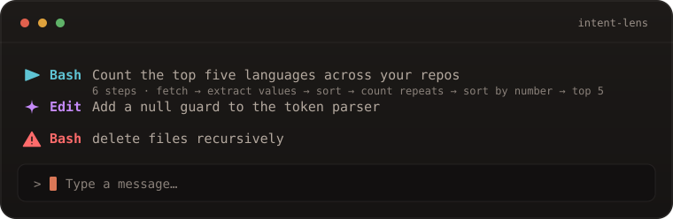

<h1 align="center">claude-mods</h1>

<p align="center"><em>Small, single-purpose mods for Claude Code.</em></p>

<p align="center">
  <a href="https://github.com/Dhananjay-JSR/claude-mods/actions/workflows/ci.yml"></a>
  
  
</p>

One marketplace, a few mods, each doing one thing well. Every mod runs locally, carries no dependencies, and says what it reaches for before it runs.

## Install

```
/plugin marketplace add Dhananjay-JSR/claude-mods
```

That registers the catalog once. Install only the mods you want, below.

## Mods

### [intent-lens](plugins/intent-lens)

See what Claude is about to do, in one line above the prompt — and a red warning before a destructive shell command.

<p align="center">
  
</p>

```
/plugin install intent-lens@claude-mods
```

[Read the docs →](plugins/intent-lens)

Each mod has its own README with commands, internals, and limits. More land here as they are finished.

## How the library works

- Every mod is a plugin in `plugins/<name>/`, with one entry in `.claude-plugin/marketplace.json`.
- You register the marketplace once; each mod installs, versions, and updates on its own.
- After a release, `claude plugin update <name>` picks it up.

## Trust

A mod runs inside Claude Code's own process, with the permissions of your session. That is powerful, so this collection keeps the surface small:

- no npm imports, and no ambient filesystem or network access;
- every mods-API call is visible to `claude plugin validate`;
- CI validates the marketplace and the plugin, then installs from the entry on every push.

To inspect a mod before installing it:

```bash
claude plugin validate plugins/intent-lens
```

or read `plugins/intent-lens/hooks/register.js`. A mod is small enough to audit in a sitting.

## Add a mod

```text
plugins/<name>/
├── .claude-plugin/plugin.json
├── hooks/hooks.json            {"modules": ["./register.js"]}
└── hooks/register.js
```

1. Add the plugin folder.
2. Add one entry to `.claude-plugin/marketplace.json`:

   ```json
   { "name": "<name>", "source": "<name>", "description": "One line." }
   ```

   Bare names resolve under `metadata.pluginRoot`, so the path stays short.
3. Run `claude plugin validate .` and the mod's tests.
4. List it under **Mods**.

## Requirements

A current Claude Code. With Homebrew:

```bash
brew install --cask claude-code
brew upgrade --cask claude-code
```

## License

MIT.
