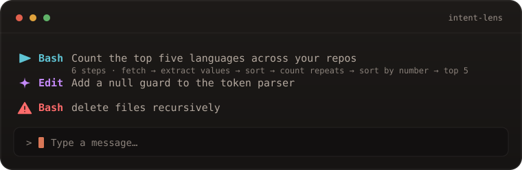

<p align="center">
  
</p>

<h1 align="center">intent-lens</h1>

<p align="center"><em>See what Claude is about to do — before it does it.</em></p>

<p align="center"><sub>Part of the <a href="https://github.com/Dhananjay-JSR/claude-mods">claude-mods</a> marketplace.</sub></p>

<p align="center">
  <a href="https://github.com/Dhananjay-JSR/claude-mods/actions/workflows/ci.yml"></a>
  
  
  
</p>

<p align="center">
  
</p>

A **Claude Mod** that shows the intent of a tool call in one line above the prompt, while the call is still pending.

Claude Code shows you a tool *row* after Claude has already decided to act. `intent-lens` translates the call into a human sentence first, in the place your eyes already are. It reads either the tool's own arguments (free, instant) or asks Claude to phrase it (a few tokens).

## Install

### From the marketplace

Register the catalog once, then install this mod:

```
/plugin marketplace add Dhananjay-JSR/claude-mods
/plugin install intent-lens --marketplace Dhananjay-JSR/claude-mods
```

From your shell:

```bash
claude plugin marketplace add Dhananjay-JSR/claude-mods
claude plugin install intent-lens@claude-mods
```

Installs are cached. To take a newer version later:

```bash
claude plugin update intent-lens
```

### For one session

```bash
claude --plugin-dir /path/to/claude-mods/plugins/intent-lens
```

To load it without typing the flag, alias it in your shell:

```bash
alias claude-lens='claude --plugin-dir /path/to/claude-mods/plugins/intent-lens'
```

To load it in every session, add the directory to `CLAUDE_CODE_PLUGIN_DIRS` (`:`-separated).

Check it loaded with `/plugin` (Tab to **Installed**) or just run `/intent`.

## Two engines

| Marker | Engine | What it does | Cost |
| :- | :- | :- | :- |
| `▸` cyan | **local** | Deterministic translation of the tool's arguments | none |
| `✦` magenta | **model** | Claude writes the line from the tool, its arguments, and the local draft | at most 60 output tokens per call, plus the prompt |
| `⚠` red | **risk** | Always local: a destructive shell command is never sent to the model | none |

`auto` (the default) draws the local line immediately, then upgrades it with Claude for the calls that read worst — edits, unknown tools, and MCP tools. The band never sits blank while the model thinks.

```
▸ Bash   tidy up the build output — rm -rf dist && npm run build
✦ Edit   Add a null guard to the token parser
⚠ Bash   delete files recursively — rm -rf ~/projects/old
```

Switch engines with `/intent mode local`, `auto`, or `model`.

## Commands

| Command | What it does |
| :- | :- |
| `/intent` | Show the current state and usage |
| `/intent on` / `off` / `toggle` | Show or hide the band line (persisted). Warnings still fire when off. |
| `/intent mode local\|auto\|model` | Choose the engine (persisted) |
| `/intent log` | The last 20 calls with `✓` / `✗` outcomes and their engine |
| `/intent clear` | Forget the history |
| `/intent-log` | Same as `/intent log` |

## How the intent is worked out

The local engine is a pure function of the tool name and arguments — no I/O, no latency.

| Tool | What it says |
| :- | :- |
| `Bash` | Claude's own `description` for the command, then the command itself |
| `Read` | `~/app/src/auth.ts:10-20` |
| `Edit` | `~/app/src/auth.ts (12 lines → 24 lines)` |
| `Write` | `~/app/notes.md (48 lines)` |
| `Grep` | `"useEffect" in ~/app/src` |
| `Glob` | `**/*.test.ts under ~/app` |
| `WebFetch` / `WebSearch` | `developer.mozilla.org` / `"…" on the web` |
| `Task` / `Agent` | `explore subagent — find the auth middleware` |
| `TodoWrite` | `update the task list (6 items)` |
| `AskUserQuestion` | `ask you: Which database should this use?` |
| `mcp__server__tool` | `server:tool` |
| anything else | Its first two string arguments, so new tools still say something |

`Bash` is the interesting one: Claude Code's Bash tool already requires Claude to describe each command, so that description **is** the stated intent — normally buried in the tool row.

The model engine sends the tool name, a bounded view of the arguments (900 characters), and the local draft to `haiku`. It asks for at most 12 words, hard-caps the answer at 110 characters, and waits at most 1.5 seconds. A failure, a refusal, or a slow reply silently keeps the local line: the intent must never break a call.

## Risk detection

Shell commands are matched against patterns that can destroy work or reach outside the project: recursive `rm`, `git reset --hard`, `git clean -fd`, force-push, `DROP`/`TRUNCATE`, `mkfs`/`dd`, fork bombs, `curl … | sh`, `sudo`, `chmod -R 777`, package publishes.

A match turns the marker red and raises a toast. It is computed locally and always shown — in `model` mode, and even when the band is hidden. It is a **reminder, not a sandbox**: it matches the text of the command.

## Privacy and cost

- **`local` mode** sends nothing anywhere and costs no tokens.
- **`auto` mode** calls the model only for edits, unknown tools, and MCP tools — a few hundred tokens per edit.
- **`model` mode** calls it for every tool call, which adds up to 1.5 seconds of latency per call.
- Model calls use your own Claude Code credentials and go through `$.model.complete`, exactly like any other request the session makes.
- Headless runs (`claude -p`, Agent SDK) never raise `ui.render`, and the mod calls the model only after that event has fired, so such a run spends nothing.

## Design notes

A Claude Mod runs inside Claude Code's own process, so the rules are strict:

- **No npm imports.** Only relative imports and the `claude-code` module, so Claude Code can read the whole mod before running it.
- **No ambient `fs` or `fetch`.** Every side effect goes through the `$` API, which `claude plugin validate` lists.
- **Observes, never edits.** The `tool.call` hook passes the call and its result through unchanged. The render hook wraps the band without replacing it, and the command hooks answer only their own commands. Nothing here can block, rewrite, or approve a tool call.

```
❯ ./register.js hooks: session.start, tool.call, ui.render{component=AbovePrompt}, command.run{command=intent}, command.run{command=intent-log}
❯ ./register.js calls: $.clock.after (via withDeadline), $.command.register, $.model.complete (via modelIntent), $.store.get, $.store.set, $.ui.invalidate, $.ui.resolve, $.ui.toast
✔ Validation passed
```

## Layout

```
plugins/intent-lens/
├── .claude-plugin/plugin.json   the manifest
├── hooks/hooks.json             {"modules": ["./register.js"]} — makes it a mod
├── hooks/register.js            hooks, both engines, risk rules
├── tests/intent.test.mjs        hooks run against a stubbed API
├── assets/logo.svg              the mark
└── assets/demo.svg              the band, illustrated
```

## Tests

`claude plugin test` runs `.test.ts` files inside a session; these tests are plain Node instead, so they need no session, network, or credentials. They load the hooks module from a temporary copy and fire every hook — including `session.start` — against a stubbed mods API. Each test gets a fresh copy of the module, so one test's mode, history, or UI flag can never leak into the next.

```bash
node tests/intent.test.mjs
# 42 pass, 0 fail
```

Run it from this folder. The repository's CI runs the same tests and `claude plugin validate --strict` on every push, then installs the plugin from the marketplace entry to prove that path works too.

## Limitations

- The band shows the **most recent** call, not a queue of parallel ones.
- Nothing is drawn in headless runs, where there is no UI.
- The model line is a hint about what Claude *says* it is doing; the arguments are the ground truth.
- The band is a shared surface: it sits above whatever other mods draw, and the user can collapse it with `Ctrl+X Ctrl+A`.

## License

MIT.
